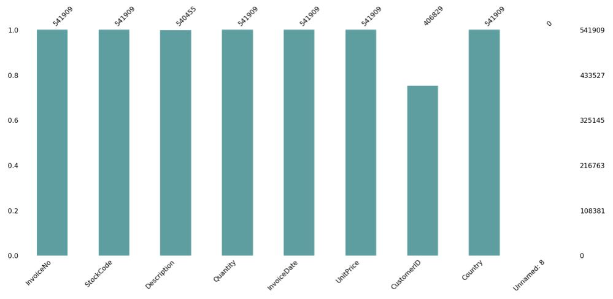
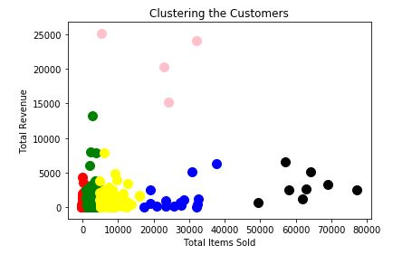
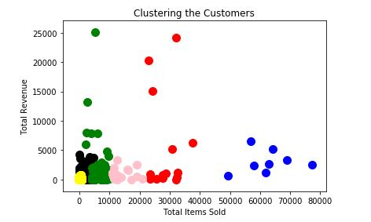
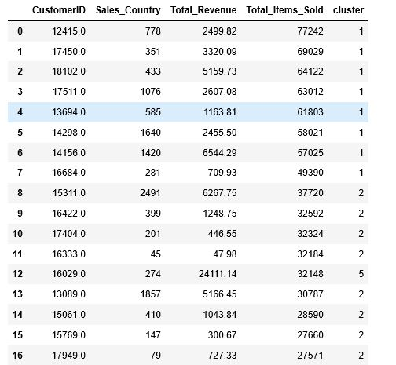

# UK-High-Value-Clients-Identifiction
Identifying high value clients from a dataset via k-means clustering

## Reproduce the analysis

Install the notebook dependencies from this directory:

```bash
python3 -m pip install -r requirements.txt
jupyter notebook "High Value Clients UK.ipynb"
```

The notebook reads `Ecommerce.zip` directly. Customer revenue is net sales
(`UNITPRICE * QUANTITY`), so returned quantities reduce revenue. K-means uses
the same MinMax-scaled item and revenue features for both the elbow calculation
and final clusters, with a fixed random seed. The notebook clears saved outputs
when its analysis changes; rerun all cells before using its charts or cluster
assignments.

Submition for a Kaggle task: https://www.kaggle.com/vik2012kvs/high-value-customers-identification

Background of Problem Statement:
A UK-based online retail store has captured the sales data for different products for the period of one year (Nov 2016 to Dec 2017). The organization sells gifts primarily on the online platform. The customers who make a purchase consume directly for themselves. There are small businesses that buy in bulk and sell to other customers through the retail outlet channel.

Project Objective:
Find significant customers for the business who make high purchases of their favourite products. The organization wants to roll out a loyalty program to the high-value customers after identification of segments. Use the clustering methodology to segment customers into groups.

With the first look at the data, there was an issue with the missing values, that neede to be addressed to eliminate bias.



Clustering:



Dendrogram:



Final table with assigned clusters to each Customer ID:


